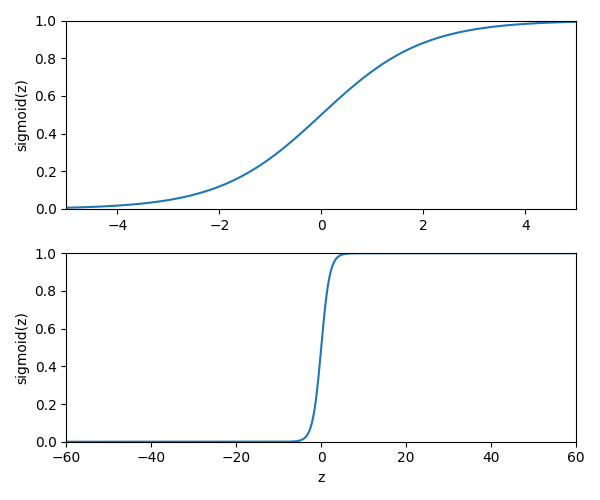
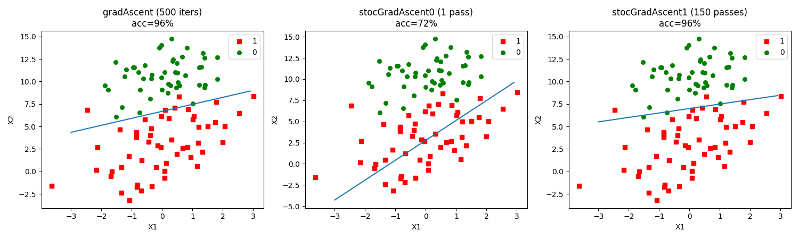

# Logistic 回归：预测疝气病马的死亡率（Logistic Regression）

《机器学习实战》（Machine Learning in Action）第 5 章的 Python 3 实现：从零手写 Logistic 回归，用梯度上升法求最佳回归系数，完成

1. **二维数据的线性分类**（`testSet.txt`，100 个样本，可视化决策边界）
2. **从疝气病症预测病马的死亡率**（[UCI Horse Colic](https://archive.ics.uci.edu/dataset/47/horse+colic) 数据集，299 个训练样本 + 67 个测试样本）

不依赖 scikit-learn，只用 NumPy 实现，适合用来理解 Logistic 回归和梯度上升法的每一步计算。

---

## 目录

- [快速开始](#快速开始)
- [项目结构](#项目结构)
- [Logistic 回归原理详解](#logistic-回归原理详解)
  - [1. 从线性回归到分类](#1-从线性回归到分类)
  - [2. Sigmoid 函数](#2-sigmoid-函数)
  - [3. 决策边界](#3-决策边界)
  - [4. 极大似然估计](#4-极大似然估计)
  - [5. 梯度推导](#5-梯度推导)
  - [6. 梯度上升法](#6-梯度上升法)
  - [7. 随机梯度上升](#7-随机梯度上升)
  - [8. 改进的随机梯度上升](#8-改进的随机梯度上升)
  - [9. 完整计算示例](#9-完整计算示例)
  - [10. 优缺点](#10-优缺点)
- [示例一：二维数据分类](#示例一二维数据分类)
- [示例二：疝气病马死亡率预测](#示例二疝气病马死亡率预测)
- [代码与公式对照](#代码与公式对照)
- [实验结果](#实验结果)

---

## 快速开始

```bash
pip install -r requirements.txt

# 疝气病马预测：训练 + 测试 10 次，输出平均错误率
python logRegres.py

# 二维数据：分别用三种优化算法训练并画出决策边界
python -c "import numpy as np, logRegres as lr; d,l = lr.loadDataSet(); lr.plotBestFit(lr.gradAscent(np.array(d), l))"
python -c "import numpy as np, logRegres as lr; d,l = lr.loadDataSet(); lr.plotBestFit(lr.stocGradAscent0(np.array(d), l))"
python -c "import numpy as np, logRegres as lr; d,l = lr.loadDataSet(); lr.plotBestFit(lr.stocGradAscent1(np.array(d), l))"
```

## 项目结构

```
.
├── logRegres.py            # 全部算法实现
├── testSet.txt             # 二维示例数据：X1  X2  标签
├── horseColicTraining.txt  # 疝气病马训练集（299 行 × 22 列）
├── horseColicTest.txt      # 疝气病马测试集（67 行 × 22 列）
├── images/                 # README 中的图
└── EXTRAS/                 # 书中绘图用的辅助脚本
    ├── sigmoidPlot.py      # Sigmoid 函数曲线
    ├── plotGD.py           # 梯度上升示意图
    ├── plot2D.py           # 二维数据与决策边界
    └── plotSDerror.py      # 随机梯度上升中回归系数随迭代的变化
```

---

## Logistic 回归原理详解

### 1. 从线性回归到分类

线性回归用特征的加权和来预测一个连续值：

$$z = w_0 x_0 + w_1 x_1 + \dots + w_n x_n = \mathbf{w}^\top \mathbf{x}$$

其中 $x_0 = 1$ 是为了让 $w_0$ 充当截距（偏置），这就是 `loadDataSet` 在每行数据前面加 `1.0` 的原因。

但二分类问题的输出只有 0 和 1，$z$ 却可以是任意实数。我们需要一个函数，把 $(-\infty, +\infty)$ 压缩到 $(0, 1)$，并把结果解释为"属于类别 1 的概率"。

### 2. Sigmoid 函数

$$\sigma(z) = \frac{1}{1 + e^{-z}}$$



| 性质 | 说明 |
|---|---|
| 值域 | $(0, 1)$，可以当作概率 |
| $\sigma(0) = 0.5$ | 正好是分类阈值 |
| 单调递增 | $z$ 越大，属于类别 1 的概率越大 |
| 对称性 | $\sigma(-z) = 1 - \sigma(z)$ |
| 导数 | $\sigma'(z) = \sigma(z)\,(1 - \sigma(z))$，求梯度时非常方便 |

从上图可以看到，在小尺度（上）下 Sigmoid 是一条平滑的 S 形曲线；在大尺度（下）下它近似一个阶跃函数。

Logistic 回归模型：

$$P(y = 1 \mid \mathbf{x}) = \sigma(\mathbf{w}^\top \mathbf{x}) = \frac{1}{1 + e^{-\mathbf{w}^\top \mathbf{x}}}$$

**分类规则**：$\sigma(\mathbf{w}^\top\mathbf{x}) > 0.5$ 判为 1，否则判为 0（`classifyVector`）。

> 换个角度看：对上式变形得 $\ln\dfrac{P(y=1)}{P(y=0)} = \mathbf{w}^\top\mathbf{x}$，即 **对数几率（log-odds）是特征的线性函数**，这也是 Logistic 回归又叫"对数几率回归"的原因。

### 3. 决策边界

$\sigma(z) = 0.5 \iff z = 0$，所以决策边界是

$$w_0 + w_1 x_1 + w_2 x_2 = 0 \quad\Longrightarrow\quad x_2 = \frac{-w_0 - w_1 x_1}{w_2}$$

这是一条直线，`plotBestFit` 中 `y = (-weights[0]-weights[1]*x)/weights[2]` 就是在画它。因此 Logistic 回归是一个 **线性分类器**。

### 4. 极大似然估计

如何找到最好的 $\mathbf{w}$？令 $h_i = \sigma(\mathbf{w}^\top \mathbf{x}_i)$，那么单个样本的概率可以统一写成：

$$P(y_i \mid \mathbf{x}_i; \mathbf{w}) = h_i^{\,y_i}\,(1 - h_i)^{1 - y_i}$$

（$y_i=1$ 时等于 $h_i$，$y_i=0$ 时等于 $1-h_i$。）

假设 $m$ 个样本独立，整个训练集的似然函数为

$$L(\mathbf{w}) = \prod_{i=1}^{m} h_i^{\,y_i}\,(1 - h_i)^{1 - y_i}$$

取对数，得到 **对数似然函数**：

$$\ell(\mathbf{w}) = \sum_{i=1}^{m} \Big[\, y_i \ln h_i + (1 - y_i)\ln(1 - h_i) \,\Big]$$

我们要找让 $\ell(\mathbf{w})$ **最大** 的 $\mathbf{w}$。（$-\ell(\mathbf{w})$ 就是常说的交叉熵损失，最大化似然等价于最小化交叉熵。）

### 5. 梯度推导

利用 $\sigma'(z) = \sigma(z)(1-\sigma(z))$，以及 $\dfrac{\partial z_i}{\partial w_j} = x_{ij}$：

$$\frac{\partial \ell}{\partial w_j} = \sum_{i=1}^{m}\left[\frac{y_i}{h_i} - \frac{1 - y_i}{1 - h_i}\right] h_i (1 - h_i)\, x_{ij} = \sum_{i=1}^{m}\big[\, y_i(1-h_i) - (1-y_i)h_i \,\big]\, x_{ij}$$

$$\boxed{\frac{\partial \ell}{\partial w_j} = \sum_{i=1}^{m} (y_i - h_i)\, x_{ij}}$$

写成矩阵形式（$X$ 是 $m\times n$ 数据矩阵，$\mathbf{y}$、$\mathbf{h}$ 是 $m\times 1$ 向量）：

$$\nabla_{\mathbf{w}}\,\ell = X^\top (\mathbf{y} - \mathbf{h})$$

结果非常简洁：**误差（真实标签 − 预测概率）乘以特征，再求和**。

### 6. 梯度上升法

梯度指向函数值增长最快的方向。沿梯度方向走一小步，对数似然就会增大：

$$\boxed{\mathbf{w} \leftarrow \mathbf{w} + \alpha\, X^\top(\mathbf{y} - \mathbf{h})}$$

其中 $\alpha$ 是步长（学习率）。重复直到收敛或达到最大迭代次数。

> 梯度 **上升** 求最大值，梯度 **下降** 求最小值，二者只差一个符号。书中最大化对数似然，所以用梯度上升；若最小化交叉熵损失，就是梯度下降，更新式完全相同。

对应 `gradAscent`：

```python
h = sigmoid(dataMatrix*weights)                            # h = σ(Xw)，m×1
error = (labelMat - h)                                     # y - h
weights = weights + alpha * dataMatrix.transpose()* error  # w += α Xᵀ(y - h)
```

每次更新都要用 **全部 m 个样本** 做矩阵乘法，时间复杂度为 $O(mn)$。100 个样本没问题，但样本量达到数十亿时就太慢了。

### 7. 随机梯度上升

**每次只用一个样本** 更新回归系数：

$$\mathbf{w} \leftarrow \mathbf{w} + \alpha\,(y_i - h_i)\,\mathbf{x}_i,\qquad h_i = \sigma(\mathbf{w}^\top\mathbf{x}_i)$$

对应 `stocGradAscent0`。相比批量梯度上升：

| | 批量梯度上升 `gradAscent` | 随机梯度上升 `stocGradAscent0` |
|---|---|---|
| 每次更新使用的样本 | 全部 $m$ 个 | 1 个 |
| 中间变量 | 向量 $\mathbf{h}$、$\mathbf{y}-\mathbf{h}$ | 标量 $h$、$y-h$ |
| 计算量 / 次 | $O(mn)$ | $O(n)$ |
| 在线学习 | 不支持 | 支持：新样本来了直接更新一次 |
| 收敛轨迹 | 平滑 | 抖动 |

只遍历一遍数据时，随机梯度上升的效果还不够好（见[示例一](#示例一二维数据分类)中间那张图）。用 `EXTRAS/plotSDerror.py` 观察多轮迭代中回归系数的变化可以发现：系数需要很多轮才稳定，而且因为数据中有不能正确分类的点，系数会 **周期性地剧烈波动**。

### 8. 改进的随机梯度上升

`stocGradAscent1` 做了两处改进：

**① 步长随迭代递减**

$$\alpha = \frac{4}{1 + j + i} + 0.0001$$

$j$ 是遍历轮数，$i$ 是本轮中的样本序号。开始时步长大、收敛快；后面步长越来越小，减少高频波动。常数项 $0.0001$ 保证步长永远不会降到 0，新数据仍然能产生一定影响。

**② 随机选取样本**

每轮从尚未使用的样本中随机抽一个来更新，用过就从 `dataIndex` 中删掉，减少数据顺序带来的周期性波动。

改进后，只需遍历 150 轮，得到的决策边界就和批量梯度上升 500 次的结果差不多，而计算量小得多。

> 说明：书中原版代码在随机抽样时直接用 `dataMatrix[randIndex]`，而不是 `dataMatrix[dataIndex[randIndex]]`，所以实际上并没有做到"每轮每个样本恰好用一次"，而是在前面样本中有放回地抽取。这里保留了书中的写法，结果依然有效。

### 9. 完整计算示例

用 3 个样本手工算一步批量梯度上升（$\alpha = 0.1$，初始 $\mathbf{w} = [0, 0, 0]^\top$）：

| 样本 | $x_0$ | $x_1$ | $x_2$ | $y$ |
|---|---|---|---|---|
| 1 | 1 | 1 | 2 | 1 |
| 2 | 1 | 2 | 1 | 0 |
| 3 | 1 | 3 | 3 | 1 |

**① 预测**：$z_i = \mathbf{w}^\top\mathbf{x}_i = 0$，所以 $h_i = \sigma(0) = 0.5$

**② 误差**：$\mathbf{y} - \mathbf{h} = [0.5,\ -0.5,\ 0.5]^\top$

**③ 梯度**：

$$X^\top(\mathbf{y}-\mathbf{h}) = \begin{bmatrix} 1 & 1 & 1 \\ 1 & 2 & 3 \\ 2 & 1 & 3 \end{bmatrix}\begin{bmatrix} 0.5 \\ -0.5 \\ 0.5 \end{bmatrix} = \begin{bmatrix} 0.5 \\ 1.0 \\ 2.0 \end{bmatrix}$$

**④ 更新**：$\mathbf{w} = [0,0,0]^\top + 0.1 \times [0.5, 1.0, 2.0]^\top = [0.05,\ 0.10,\ 0.20]^\top$

**⑤ 检查效果**：新的预测概率

| 样本 | $z = \mathbf{w}^\top\mathbf{x}$ | $h = \sigma(z)$ | $y$ |
|---|---|---|---|
| 1 | 0.05 + 0.10 + 0.40 = 0.55 | 0.634 | 1 ↑ |
| 2 | 0.05 + 0.20 + 0.20 = 0.45 | 0.611 | 0 ↑ |
| 3 | 0.05 + 0.30 + 0.60 = 0.95 | 0.721 | 1 ↑ |

两个正样本的概率都上升了；样本 2 的概率也略升，因为第一步主要由 $x_2$ 大的正样本主导，继续迭代后 $w_1$ 会逐渐变小（样本 2 的 $x_1$ 大但标签为 0），把它推回 0.5 以下。这就是"误差 × 特征"在一步步修正权重。

### 10. 优缺点

**优点**
- 计算代价低，训练和预测都很快，适合大规模数据和在线学习
- 输出的是概率，而不只是类别
- 模型可解释：$w_j$ 的符号和大小反映了特征 $j$ 对结果的影响方向和强度（需要特征尺度一致）

**缺点**
- 只能学到线性决策边界，非线性问题需要手动构造特征（如多项式特征）
- 容易欠拟合，分类精度可能不高
- 对特征尺度敏感，未标准化时梯度上升可能收敛慢，甚至因 $e^{-z}$ 溢出产生警告

---

## 示例一：二维数据分类

`testSet.txt` 每行是 `X1  X2  标签`，共 100 个样本。下图对比三种优化算法得到的决策边界和训练集准确率：



| 算法 | 迭代 | 回归系数 $[w_0, w_1, w_2]$ | 训练集准确率 |
|---|---|---|---|
| `gradAscent` | 500 次（每次用全部样本） | [4.124, 0.480, −0.617] | 96% |
| `stocGradAscent0` | 1 遍（100 次更新） | [1.017, 0.859, −0.366] | 72% |
| `stocGradAscent1` | 150 遍 | 约 [13.4, 0.9, −1.9]（每次运行略有不同） | 约 96% |

## 示例二：疝气病马死亡率预测

### 数据集

数据来自 [UCI Horse Colic](https://archive.ics.uci.edu/dataset/47/horse+colic)。原始数据有 28 列，约 30% 的值缺失（`?`）。书中做了以下预处理：

1. **删除 7 列**：医院编号（第 3 列）、手术病变（第 24 列）、病变类型（第 25–27 列）、病理数据（第 28 列），并把 outcome（第 23 列）转换为标签
2. **缺失值替换为 0**：Logistic 回归中，特征值为 0 时 $w_j \leftarrow w_j + \alpha\,(y-h)\cdot 0$ 不会更新该系数；同时 $\sigma(0)=0.5$，不偏向任何一类。数据中特征值几乎不取 0，所以这样处理不会和真实值混淆
3. **标签缺失的样本直接丢弃**（类别标签不能像特征一样补 0）

预处理后每行 22 列（制表符分隔）：**前 21 列为特征，第 22 列为标签**。

| 列 | 特征 | 说明 |
|---|---|---|
| 1 | surgery | 是否做过手术（1 = 是，2 = 否） |
| 2 | age | 年龄（1 = 成年马，2 = 幼马；原始数据中也有 9） |
| 3 | rectal temperature | 直肠温度（℃） |
| 4 | pulse | 脉搏（次/分） |
| 5 | respiratory rate | 呼吸频率 |
| 6 | temperature of extremities | 四肢温度 |
| 7 | peripheral pulse | 外周脉搏 |
| 8 | mucous membranes | 黏膜颜色 |
| 9 | capillary refill time | 毛细血管再充盈时间 |
| 10 | pain | 疼痛程度 |
| 11 | peristalsis | 肠蠕动 |
| 12 | abdominal distension | 腹胀程度 |
| 13 | nasogastric tube | 鼻胃管排气 |
| 14 | nasogastric reflux | 鼻胃管反流量 |
| 15 | nasogastric reflux PH | 反流液 pH |
| 16 | rectal examination – feces | 直肠检查：粪便 |
| 17 | abdomen | 腹部检查 |
| 18 | packed cell volume | 红细胞压积 |
| 19 | total protein | 总蛋白 |
| 20 | abdominocentesis appearance | 腹腔穿刺液外观 |
| 21 | abdomcentesis total protein | 腹腔穿刺液总蛋白 |
| **22** | **标签** | **1 = 存活；0 = 死亡或被安乐死**（由原始 outcome 的 1 / 2、3 转换而来） |

### 流程

1. `colicTest` 读取训练集，取前 21 列作为特征、第 22 列作为标签
2. 用 `stocGradAscent1` 迭代 1000 轮训练回归系数
3. 对测试集每个样本调用 `classifyVector`：$\sigma(\mathbf{w}^\top\mathbf{x}) > 0.5$ 判为存活
4. 统计错误率
5. `multiTest` 重复 10 次取平均（随机梯度上升每次结果不同）

---

## 代码与公式对照

| 函数 | 作用 | 对应原理 |
|---|---|---|
| `loadDataSet` | 读取 `testSet.txt`，每行前补 $x_0 = 1$ | §1 |
| `sigmoid` | $\sigma(z) = 1/(1+e^{-z})$ | §2 |
| `gradAscent` | 批量梯度上升：$\mathbf{w} \mathrel{+}= \alpha X^\top(\mathbf{y}-\mathbf{h})$，500 次 | §5 §6 |
| `stocGradAscent0` | 随机梯度上升，固定步长 0.01，遍历 1 遍 | §7 |
| `stocGradAscent1` | 改进的随机梯度上升：步长递减 + 随机抽样 | §8 |
| `plotBestFit` | 画数据点和决策边界 $x_2 = (-w_0 - w_1x_1)/w_2$ | §3 |
| `classifyVector` | $\sigma(\mathbf{w}^\top\mathbf{x}) > 0.5$ 判为 1 | §2 |
| `colicTest` | 疝气病马数据训练 + 测试，返回错误率 | 示例二 |
| `multiTest` | 运行 10 次 `colicTest`，输出平均错误率 | 示例二 |

## 实验结果

```
the error rate of this test is: 0.417910
the error rate of this test is: 0.313433
the error rate of this test is: 0.343284
the error rate of this test is: 0.358209
the error rate of this test is: 0.402985
the error rate of this test is: 0.388060
the error rate of this test is: 0.328358
the error rate of this test is: 0.313433
the error rate of this test is: 0.343284
the error rate of this test is: 0.328358
after 10 iterations the average error rate is: 0.353731
```

- 平均错误率约 **35%**，与书中结果（约 35%）一致。考虑到数据中约 30% 的值缺失，这个结果并不差
- 运行时可能出现 `RuntimeWarning: overflow encountered in exp`：特征未标准化（如脉搏可达 100 以上），$\mathbf{w}^\top\mathbf{x}$ 很大时 $e^{-z}$ 溢出，此时 `sigmoid` 返回 0 或 1，不影响分类结果
- 进一步降低错误率的方法：特征标准化、调整迭代次数和步长、用更合理的方式填补缺失值

## 相比书中原版代码的改动

- Python 3 适配：`range` 对象不支持 `del`，`stocGradAscent1` 中改为 `dataIndex = list(range(m))`；`EXTRAS/plotSDerror.py` 中 `print` 语句改为函数
- 用 `np.asmatrix` 替代已弃用的 `np.mat`
- 按脚本所在目录定位数据文件，可在任意工作目录运行；`EXTRAS` 中的脚本也会自动把上级目录加入 `sys.path` 来导入 `logRegres`
- `plotBestFit` 同时支持矩阵形式 $(n,1)$ 和一维数组形式的回归系数
